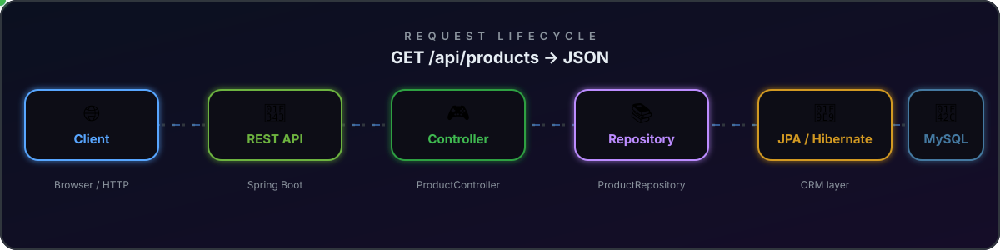
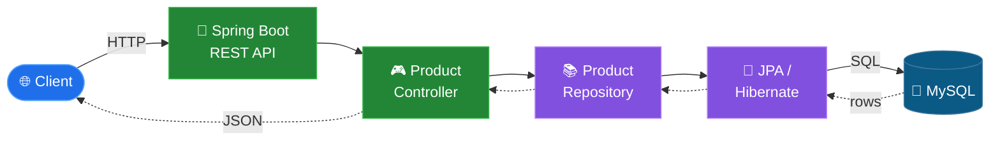
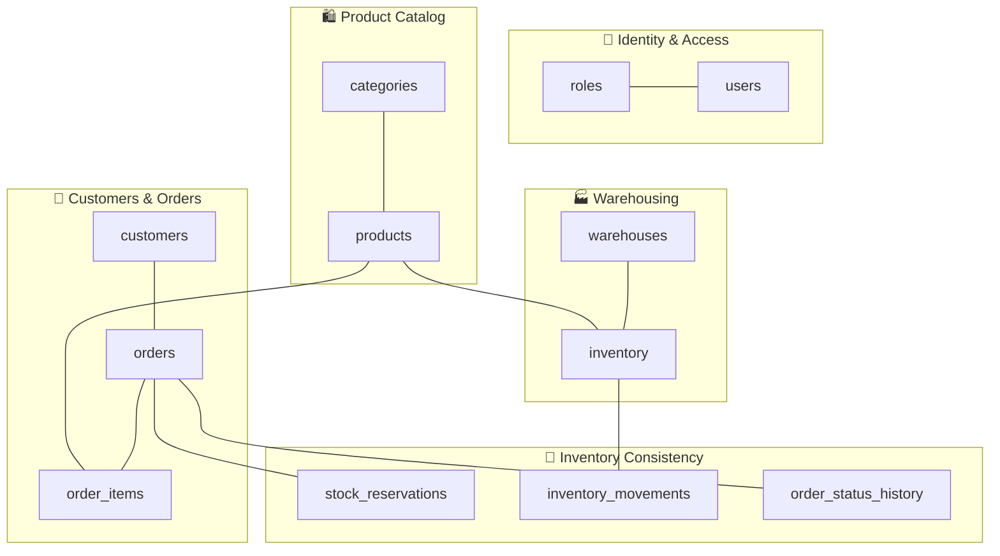

<div align="center">



<br/>

<a href="https://github.com/SarangRaj01/ProjectDBMS"></a>

<br/>


<br/>

**[✨ Features](#-current-features)** &nbsp;·&nbsp;
**[🏗️ Architecture](#%EF%B8%8F-architecture)** &nbsp;·&nbsp;
**[🗃️ Database](#%EF%B8%8F-database-design)** &nbsp;·&nbsp;
**[🔌 API Reference](#-api-endpoints)** &nbsp;·&nbsp;
**[🧪 Testing](#-automated-testing)** &nbsp;·&nbsp;
**[🚀 Quick Start](#-getting-started)**

</div>


## 🌌 The Problem

> *Two customers. One last item. Same millisecond.*

Inventory systems must keep stock accurate while orders, reservations, and warehouse operations happen simultaneously. Get it wrong and you get **overselling**, **phantom inventory**, and **partial corrupt order states**.

This project solves that challenge with:
- **Pessimistic Row-Level Locking (`SELECT ... FOR UPDATE`)**: Serializes concurrent reservation requests targeting the same inventory row in MySQL InnoDB.
- **Transactional Atomicity (`@Transactional`)**: Orders with multiple items succeed completely or roll back automatically with zero orphaned reservations.
- **Idempotent Order Submissions**: Submissions with identical idempotency keys return the existing record without double-reserving inventory.
- **Audit Trails**: Complete historical traceability through `inventory_movements` and `order_status_history`.


## ✨ Features & Implemented Capabilities

| Domain | Implemented Features |
| :--- | :--- |
| 🛡️ **Concurrency Defense** | Pessimistic row locking, `@Version` optimistic checks, and DB `CHECK (reserved_quantity <= on_hand_quantity)` |
| 📦 **Product Catalog** | Product CRUD, multi-criteria search by query, category, and status, SKU duplicate protection |
| 🏭 **Warehousing** | Multi-warehouse support, real-time inventory tracking, computed available stock |
| 🛒 **Order Processing** | Atomic multi-product order placement, line & total price computation via `BigDecimal`, idempotency protection |
| 🔄 **Safe Cancellation** | Order cancellation releases reserved stock exactly once; duplicate cancellation rejected |
| 🎨 **Frontend Dashboard** | Modern React + Vite responsive dark-mode dashboard with live stock indicators and order placement modal |
| 🧪 **Test Suite** | 16 automated unit, WebMvc, and multi-threaded concurrency tests (`CyclicBarrier`) |


## 🛠️ Technology Stack

<div align="center">


</div>

<br/>

| Technology | Purpose |
| :--- | :--- |
| ☕ **Java 21** | Backend programming |
| 🍃 **Spring Boot** | REST API and application framework |
| 🧩 **Spring Data JPA / Hibernate** | Database access and object-relational mapping |
| 🐬 **MySQL 8** | Relational data storage |
| 📦 **Maven** | Dependency and build management |
| 🐙 **Git & GitHub** | Version control and project hosting |


## 🏗️ Architecture



<details>
<summary><b>📐 View as a diagram (Mermaid)</b></summary>



</details>


## 🗃️ Database Design

**12 tables** across five domains:



| Domain | Tables |
| :--- | :--- |
| 🔐 **Identity & access** | `roles` · `users` |
| 🛍️ **Product catalog** | `categories` · `products` |
| 🏭 **Warehousing** | `warehouses` · `inventory` |
| 👥 **Customers & orders** | `customers` · `orders` · `order_items` |
| 🔄 **Inventory consistency** | `stock_reservations` · `inventory_movements` · `order_status_history` |

> 📁 Schema definitions, seed data, and SQL test scripts live in [`database/`](database/).


## 🚀 Getting Started

**Prerequisites:** &nbsp; ☕ JDK 21 &nbsp;·&nbsp; 🐬 MySQL Server 8 &nbsp;·&nbsp; 🐙 Git

### 1️⃣ &nbsp;Clone

```bash
git clone https://github.com/SarangRaj01/ProjectDBMS.git
cd ProjectDBMS
```

### 2️⃣ &nbsp;Create the database

```sql
CREATE DATABASE inventory_system;
```

Then run the migration files in `database/migrations/` **in version order**, followed by the seed scripts in `database/seed-data/`.

### 3️⃣ &nbsp;Configure credentials

Create `backend/src/main/resources/application-local.properties` and set your MySQL username and password.

### 4️⃣ &nbsp;Launch the Backend
From the `backend/` directory:

```bash
.\mvnw.cmd spring-boot:run
```

The backend starts on port **8080**.

### 5️⃣ &nbsp;Launch the Frontend Dashboard
From the `frontend/` directory:

```bash
npm run dev
```

Open `http://localhost:5173` to interact with the real-time inventory and order dashboard!


## 🔌 API Endpoints

### 📦 Products (`/api/products`)

| Method | Endpoint | Description |
|:--|:--|:--|
| `GET` | `/api/products` | List all active products |
| `GET` | `/api/products/{id}` | Get product by ID (returns 404 if not found) |
| `GET` | `/api/products/search?query=...&categoryId=...&status=...` | Search and filter products |
| `POST` | `/api/products` | Create a new product (validates SKU uniqueness) |
| `PUT` | `/api/products/{id}` | Update product information |

### 🏭 Warehouses & Inventory (`/api/warehouses`, `/api/inventory`)

| Method | Endpoint | Description |
|:--|:--|:--|
| `GET` | `/api/warehouses` | List all warehouses |
| `GET` | `/api/warehouses/{id}` | Get warehouse by ID |
| `GET` | `/api/inventory?productId=...&warehouseId=...` | View stock with dynamic available calculation |
| `GET` | `/api/inventory/product/{pId}/warehouse/{wId}` | View stock for specific product in a warehouse |

### 🛒 Orders (`/api/orders`)

| Method | Endpoint | Description |
|:--|:--|:--|
| `GET` | `/api/orders?status=...&customerId=...` | Filter and list orders |
| `GET` | `/api/orders/{id}` | Get order details with line items |
| `POST` | `/api/orders` | **Atomic order placement** with pessimistic stock reservation |
| `POST` | `/api/orders/{id}/cancel?reason=...` | **Atomic order cancellation** with exact stock release |

#### Sample: Create Order Request
```json
POST /api/orders
Content-Type: application/json

{
  "customerId": 1,
  "idempotencyKey": "ORD-20261013-001",
  "items": [
    { "productId": 2, "warehouseId": 1, "quantity": 3 }
  ]
}
```


## 🧪 Automated Testing

Run the full automated test suite containing unit, controller, and multi-threaded concurrency tests:

```bash
cd backend
.\mvnw.cmd test "-Dtest=ServiceLayerTests,ProductControllerTests,OrderServiceTests,OrderControllerTests,ConcurrentOrderReservationTests"
```

All 16 test cases run and verify:
- ✅ **Validation rejection**: Negative prices and invalid SKUs return HTTP 400.
- ✅ **Duplicate SKU**: Returns HTTP 409 Conflict.
- ✅ **Available stock formula**: Verified $Available = OnHand - Reserved$.
- ✅ **Atomic multi-item rollback**: Failure of item 2 cancels item 1's reservation.
- ✅ **Cancellation safety**: Reservation released once; duplicate cancellation rejected.
- ✅ **Multi-threaded concurrency (`CyclicBarrier`)**: Two simultaneous threads each requesting 7 units from 10 available stock $\rightarrow$ exactly 1 succeeds, 1 rejected, and stock is never oversold.


## 🎯 Learning Objectives

| | Objective |
| :---: | :--- |
| 🧬 | Design normalized relational schemas and enforce referential integrity |
| 🌐 | Implement REST APIs using Spring Boot |
| 🧩 | Use JPA and Hibernate to access MySQL |
| ⚔️ | Understand transactions, stock reservations, and concurrent inventory updates |
| 🧪 | Test database-backed application behavior |

## 📌 Project Status

> [!NOTE]
> **🚧 In progress.** The database schema, sample data, MySQL connection, and initial product listing API are implemented. Order processing, automated testing, and the frontend remain future development tasks.

<br/>

<div align="center">


*Built as a learning project focused on database design, backend engineering, and reliable inventory management.*

<br/>

**Made with ☕ and curiosity by [@SarangRaj01](https://github.com/SarangRaj01)**

⭐ **Star this repo if it taught you something** ⭐

</div>