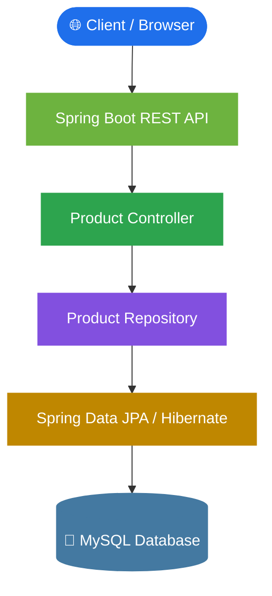

<div align="center">

# 📦 Distributed Inventory & Order Consistency System

**A database-driven inventory and order management backend built to explore reliable stock reservation and order processing across multiple warehouses.**

<br>


[Overview](#-overview) •
[Features](#-current-features) •
[Architecture](#-architecture) •
[Database](#-database-design) •
[Getting Started](#-getting-started) •
[Roadmap](#-roadmap)

</div>

---

## 📖 Overview

Inventory systems must maintain accurate stock levels while handling orders, reservations, and warehouse operations. Incorrect updates can lead to **overselling**, **inconsistent inventory**, and **unreliable order states**.

This project models these problems through a relational database and a REST API, with a focus on:

| 🔒 Transaction management | 🧱 Data integrity | 📊 Inventory consistency |
| :---: | :---: | :---: |
| Safe, atomic order and stock updates | Referential integrity across all tables | Accurate stock across multiple warehouses |

---

## ✨ Current Features

- 🗄️ **Relational schema** covering users, roles, customers, categories, products, warehouses, and inventory
- 🧾 **Order-related tables** for orders, order items, stock reservations, inventory movements, and order status history
- 🌱 **SQL migration scripts** and sample seed data
- 🔌 **Spring Boot application** connected to MySQL
- 🚀 **Working `GET /api/products` endpoint** returning product records as JSON

---

## 🛠️ Technology Stack

| Technology | Purpose |
| :--- | :--- |
| ☕ **Java 21** | Backend programming |
| 🍃 **Spring Boot** | REST API and application framework |
| 🧩 **Spring Data JPA / Hibernate** | Database access and object-relational mapping |
| 🐬 **MySQL 8** | Relational data storage |
| 📦 **Maven** | Dependency and build management |
| 🐙 **Git & GitHub** | Version control and project hosting |

---

## 🏗️ Architecture



---

## 🗃️ Database Design

The database currently includes **12 tables** grouped around five areas:

| Area | Tables |
| :--- | :--- |
| 🔐 **Identity & access** | `roles` · `users` |
| 🛍️ **Product catalog** | `categories` · `products` |
| 🏭 **Warehousing** | `warehouses` · `inventory` |
| 👥 **Customers & orders** | `customers` · `orders` · `order_items` |
| 🔄 **Inventory consistency** | `stock_reservations` · `inventory_movements` · `order_status_history` |

> 📁 Schema definitions, seed data, and SQL test scripts are maintained in the [`database/`](database/) directory.

---

## 🚀 Getting Started

### Prerequisites

- ☕ JDK 21
- 🐬 MySQL Server 8
- 🐙 Git

### 1️⃣ Clone the repository

```bash
git clone https://github.com/SarangRaj01/ProjectDBMS.git
cd ProjectDBMS
```

### 2️⃣ Create the database

Create a MySQL database named `inventory_system`, then:

1. Execute the SQL migration files in `database/migrations/` in version order.
2. Run the seed-data scripts in `database/seed-data/` to insert sample records.

```sql
CREATE DATABASE inventory_system;
```

### 3️⃣ Configure database credentials

Create `backend/src/main/resources/application-local.properties` and set your MySQL username and password there.

> [!WARNING]
> Do **not** commit this file. Make sure `backend/.gitignore` excludes it.

### 4️⃣ Run the backend

From the `backend/` directory:

```bash
# Windows
.\mvnw.cmd spring-boot:run

# macOS / Linux
./mvnw spring-boot:run
```

The backend starts on port **8080** when configuration and database validation succeed.

### 5️⃣ Try the API

```http
GET http://localhost:8080/api/products
```

The endpoint returns product records as JSON.

---

## 📂 Project Structure

```text
ProjectDBMS/
├── backend/            # Spring Boot application
├── database/
│   ├── migrations/     # Schema creation scripts
│   ├── seed-data/      # Sample data
│   └── queries/        # SQL verification and test scripts
├── docs/               # Project documentation and ER diagram
├── frontend/           # Frontend workspace
├── tests/              # Project-level tests
└── README.md
```

---

## 🗺️ Roadmap

**Progress: 3 / 9 milestones**

`███░░░░░░` 33%

- [x] Create the core relational schema and seed data
- [x] Connect Spring Boot to MySQL
- [x] Implement the product listing endpoint
- [ ] Add service-layer validation and error handling
- [ ] Implement product creation and update endpoints
- [ ] Build order placement and stock reservation workflows
- [ ] Add transaction and concurrent stock-update tests
- [ ] Build the inventory dashboard
- [ ] Add API documentation and integration tests

---

## 🎯 Learning Objectives

- Design normalized relational schemas and enforce referential integrity
- Implement REST APIs using Spring Boot
- Use JPA and Hibernate to access MySQL
- Understand transactions, stock reservations, and concurrent inventory updates
- Test database-backed application behavior

---

## 📌 Project Status

> **🚧 In progress.** The database schema, sample data, MySQL connection, and initial product listing API are implemented. Order processing, automated testing, and the frontend remain future development tasks.

---

<div align="center">

*Built as a learning project focused on database design, backend engineering, and reliable inventory management.*

⭐ If you find this project interesting, consider giving it a star!

</div>