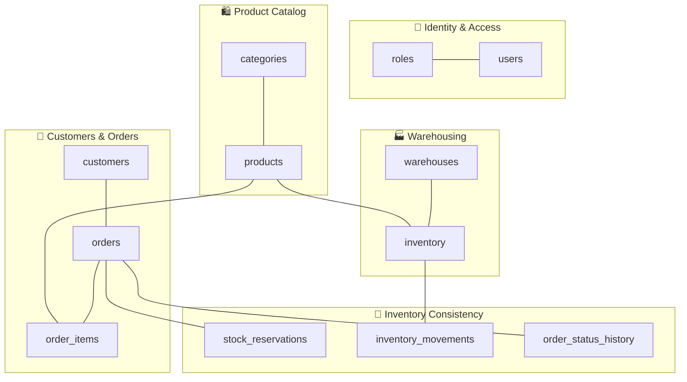
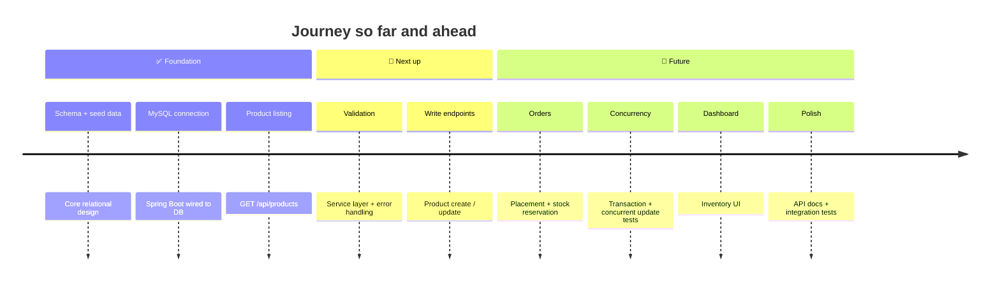

<div align="center">


<br/>

<a href="https://github.com/SarangRaj01/ProjectDBMS"></a>

<br/>


<br/>

**[✨ Features](#-current-features)** &nbsp;·&nbsp;
**[🏗️ Architecture](#%EF%B8%8F-architecture)** &nbsp;·&nbsp;
**[🗃️ Database](#%EF%B8%8F-database-design)** &nbsp;·&nbsp;
**[🚀 Quick Start](#-getting-started)** &nbsp;·&nbsp;
**[🗺️ Roadmap](#%EF%B8%8F-roadmap)**

</div>


## 🌌 The Problem

> *Two customers. One last item. Same millisecond.*

Inventory systems must keep stock accurate while orders, reservations, and warehouse operations all happen at once. Get it wrong and you get **overselling**, **phantom inventory**, and **orders stuck in impossible states**.

This project attacks that problem head-on with a relational database and a REST API, built around three ideas:

<table align="center">
  <tr>
    <td align="center" width="33%">
      <h3>🔒</h3>
      <b>Transaction<br/>Management</b><br/><br/>
      <sub>Atomic order and stock updates that succeed together or not at all</sub>
    </td>
    <td align="center" width="33%">
      <h3>🧱</h3>
      <b>Data<br/>Integrity</b><br/><br/>
      <sub>Referential integrity enforced across every table</sub>
    </td>
    <td align="center" width="33%">
      <h3>⚖️</h3>
      <b>Inventory<br/>Consistency</b><br/><br/>
      <sub>Accurate stock across multiple warehouses</sub>
    </td>
  </tr>
</table>


## ✨ Current Features

| | Feature |
| :---: | :--- |
| 🗄️ | **Relational schema** covering users, roles, customers, categories, products, warehouses, and inventory |
| 🧾 | **Order tables** for orders, order items, stock reservations, inventory movements, and order status history |
| 🌱 | **SQL migration scripts** and sample seed data |
| 🔌 | **Spring Boot application** connected to MySQL |
| 🚀 | **Working `GET /api/products` endpoint** returning product records as JSON |


## 🛠️ Technology Stack

<div align="center">


</div>

<br/>

| Technology | Purpose |
| :--- | :--- |
| ☕ **Java 21** | Backend programming |
| 🍃 **Spring Boot** | REST API and application framework |
| 🧩 **Spring Data JPA / Hibernate** | Database access and object-relational mapping |
| 🐬 **MySQL 8** | Relational data storage |
| 📦 **Maven** | Dependency and build management |
| 🐙 **Git & GitHub** | Version control and project hosting |


## 🏗️ Architecture


<details>
<summary><b>📐 View as a diagram (Mermaid)</b></summary>


</details>


## 🗃️ Database Design

**12 tables** across five domains:



| Domain | Tables |
| :--- | :--- |
| 🔐 **Identity & access** | `roles` · `users` |
| 🛍️ **Product catalog** | `categories` · `products` |
| 🏭 **Warehousing** | `warehouses` · `inventory` |
| 👥 **Customers & orders** | `customers` · `orders` · `order_items` |
| 🔄 **Inventory consistency** | `stock_reservations` · `inventory_movements` · `order_status_history` |

> 📁 Schema definitions, seed data, and SQL test scripts live in [`database/`](database/).


## 🚀 Getting Started

**Prerequisites:** &nbsp; ☕ JDK 21 &nbsp;·&nbsp; 🐬 MySQL Server 8 &nbsp;·&nbsp; 🐙 Git

### 1️⃣ &nbsp;Clone

```bash
git clone https://github.com/SarangRaj01/ProjectDBMS.git
cd ProjectDBMS
```

### 2️⃣ &nbsp;Create the database

```sql
CREATE DATABASE inventory_system;
```

Then run the migration files in `database/migrations/` **in version order**, followed by the seed scripts in `database/seed-data/`.

### 3️⃣ &nbsp;Configure credentials

Create `backend/src/main/resources/application-local.properties` and set your MySQL username and password.

> [!WARNING]
> Never commit this file. Make sure `backend/.gitignore` excludes it.

### 4️⃣ &nbsp;Launch

From the `backend/` directory:

<table>
<tr><th>🪟 Windows</th><th>🍎 macOS / 🐧 Linux</th></tr>
<tr>
<td>

```bash
.\mvnw.cmd spring-boot:run
```

</td>
<td>

```bash
./mvnw spring-boot:run
```

</td>
</tr>
</table>

The backend starts on port **8080** once configuration and database validation succeed.

### 5️⃣ &nbsp;Make your first request

```http
GET http://localhost:8080/api/products
```

> [!TIP]
> Returns product records as JSON. Open it in a browser, Postman, or `curl http://localhost:8080/api/products`.


## 📂 Project Structure

```text
ProjectDBMS/
├── 🍃 backend/            Spring Boot application
├── 🗄️ database/
│   ├── migrations/        Schema creation scripts
│   ├── seed-data/         Sample data
│   └── queries/           SQL verification and test scripts
├── 📚 docs/               Documentation, ER diagram, README assets
├── 🎨 frontend/           Frontend workspace
├── 🧪 tests/              Project-level tests
└── 📄 README.md
```


## 🗺️ Roadmap

<div align="center">

 

`🟦🟦🟦⬛⬛⬛⬛⬛⬛` &nbsp; **3 of 9 milestones complete**

</div>



- [x] Create the core relational schema and seed data
- [x] Connect Spring Boot to MySQL
- [x] Implement the product listing endpoint
- [ ] Add service-layer validation and error handling
- [ ] Implement product creation and update endpoints
- [ ] Build order placement and stock reservation workflows
- [ ] Add transaction and concurrent stock-update tests
- [ ] Build the inventory dashboard
- [ ] Add API documentation and integration tests


## 🎯 Learning Objectives

| | Objective |
| :---: | :--- |
| 🧬 | Design normalized relational schemas and enforce referential integrity |
| 🌐 | Implement REST APIs using Spring Boot |
| 🧩 | Use JPA and Hibernate to access MySQL |
| ⚔️ | Understand transactions, stock reservations, and concurrent inventory updates |
| 🧪 | Test database-backed application behavior |

## 📌 Project Status

> [!NOTE]
> **🚧 In progress.** The database schema, sample data, MySQL connection, and initial product listing API are implemented. Order processing, automated testing, and the frontend remain future development tasks.

<br/>

<div align="center">


*Built as a learning project focused on database design, backend engineering, and reliable inventory management.*

<br/>

**Made with ☕ and curiosity by [@SarangRaj01](https://github.com/SarangRaj01)**

⭐ **Star this repo if it taught you something** ⭐

</div>