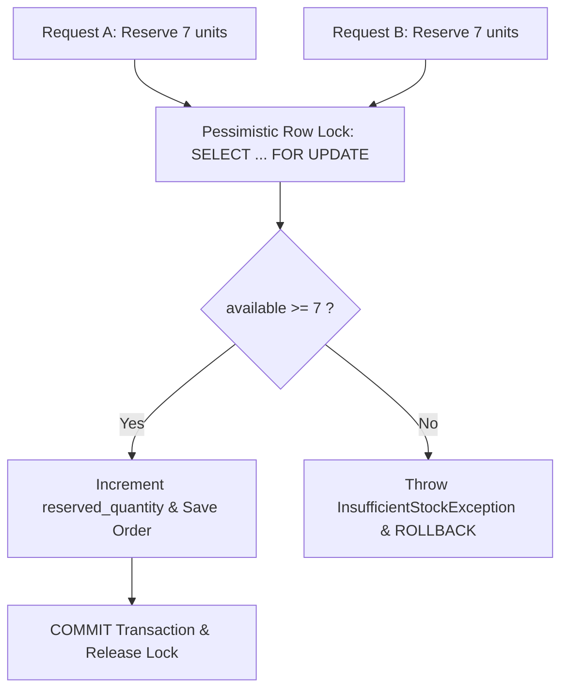

# Architecture & Concurrency Control Guide

## 1. System Overview

The **Distributed Inventory and Order Consistency System** guarantees that simultaneous customer order submissions across distributed warehouses cannot oversell available stock, leave partial reservations, or corrupt inventory quantities.

---

## 2. Inventory Invariants

For every product $P$ and warehouse $W$, the following database invariants must hold at all times:

1. **Non-negativity**: $\text{on\_hand\_quantity} \ge 0$
2. **Reserved non-negativity**: $\text{reserved\_quantity} \ge 0$
3. **Upper-bound constraint**: $\text{reserved\_quantity} \le \text{on\_hand\_quantity}$
4. **Available calculation**: $\text{available\_quantity} = \text{on\_hand\_quantity} - \text{reserved\_quantity}$

These are enforced by:
- **MySQL InnoDB Check Constraints**: `chk_inventory_on_hand` and `chk_inventory_reserved`.
- **Application Validation**: Dynamic transient calculation in `Inventory.getAvailableQuantity()`.
- **Transaction Rollbacks**: Any constraint violation causes a complete transactional rollback.

---

## 3. Concurrency Strategy: Multi-Layered Defense



### Layer 1: Pessimistic Row Locking (`SELECT ... FOR UPDATE`)
- In `InventoryRepository`:
  ```java
  @Lock(LockModeType.PESSIMISTIC_WRITE)
  @Query("SELECT i FROM Inventory i WHERE i.productId = :productId AND i.warehouseId = :warehouseId")
  Optional<Inventory> findByProductIdAndWarehouseIdForUpdate(Long productId, Long warehouseId);
  ```
- **How it works**: When Request A calls `findByProductIdAndWarehouseIdForUpdate()`, MySQL InnoDB places an exclusive write lock ($X$-lock) on the specific index record in the `inventory` table.
- When concurrent Request B attempts to access the same product in the same warehouse, Request B's transaction is paused by the MySQL engine until Request A completes (`COMMIT` or `ROLLBACK`).
- Request B then reads the updated `reserved_quantity`, accurately detects that insufficient stock remains, and is cleanly rejected with `409 Conflict`.

### Layer 2: Optimistic Locking (`@Version`)
- `Inventory.java` maps the database column `version` with `@Version private Long version;`.
- If any asynchronous job or alternate service attempts to update the row without locking, Hibernate verifies that `version` matches. If mismatched, it aborts with `OptimisticLockException`.

### Layer 3: Database Engine Constraint
- `V1__create_core_tables.sql`:
  ```sql
  CONSTRAINT chk_inventory_reserved CHECK (
      reserved_quantity >= 0 AND reserved_quantity <= on_hand_quantity
  )
  ```
- Even if application logic failed, MySQL 8 InnoDB will reject any statement violating this invariant with error code `3819`.

---

## 4. Order Lifecycle State Machine

```
              ┌───────────────┐
              │    (Entry)    │
              └───────┬───────┘
                      │ POST /api/orders (atomic reservation)
                      ▼
              ┌───────────────┐
              │   CONFIRMED   │
              └───────┬───────┘
                      │
        ┌─────────────┴─────────────┐
        │ POST /api/orders/{id}/cancel│ Fulfillment
        ▼                             ▼
┌───────────────┐             ┌───────────────┐
│   CANCELLED   │             │    SHIPPED    │
│(Stock Released│             └───────┬───────┘
│ Exactly Once) │                     │
└───────────────┘                     ▼
                              ┌───────────────┐
                              │   DELIVERED   │
                              └───────────────┘
```

### Rules & Transitions:
1. `CONFIRMED` $\rightarrow$ `CANCELLED`: releases all associated reservations (`reserved_quantity` decremented, `StockReservation.status = 'RELEASED'`).
2. `CANCELLED` $\rightarrow$ `CANCELLED`: **Prohibited**. Repeated cancellation returns `400 Bad Request` and never double-releases stock.
3. `SHIPPED` / `DELIVERED` $\rightarrow$ `CANCELLED`: **Prohibited**. Fulfilled orders cannot release reservations.

---

## 5. Auditability & History

Every state change produces immutable audit records:
- **`inventory_movements`**: Logs the exact delta (`quantity_change`), movement type (`SHIPMENT`, `RETURN`, `ADJUSTMENT`), and foreign key reference to the order.
- **`order_status_history`**: Tracks old status, new status, timestamp, and explanation string.
